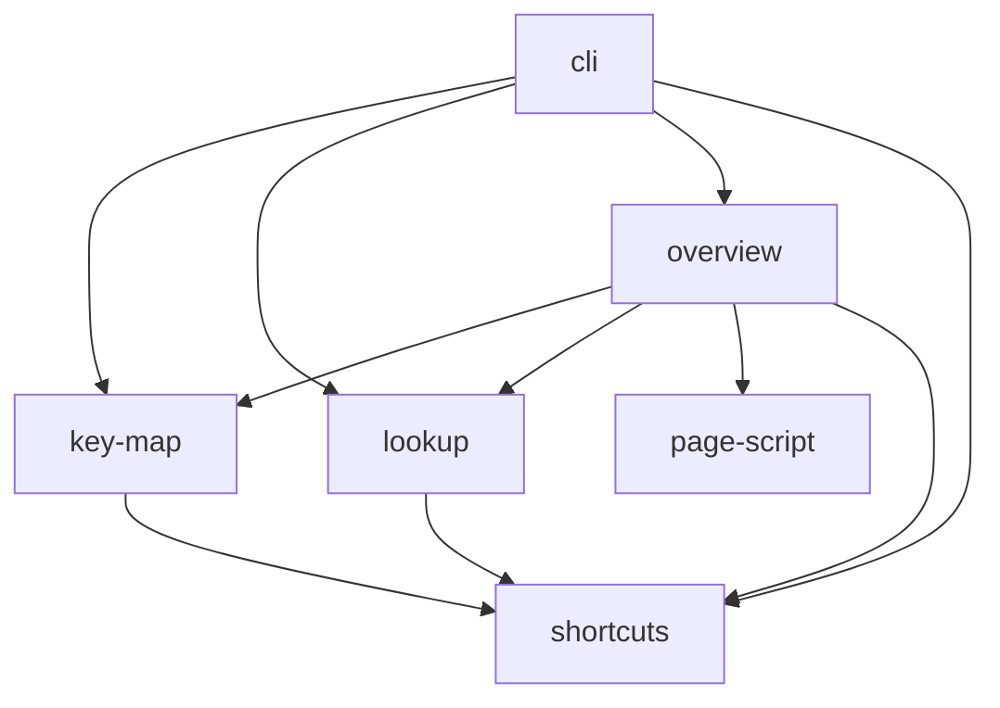

# src

The modules of the tool, for whoever changes them: their layers, which of
them touch files, and the imports between them.

## Layers

A module imports from this directory only modules of the layers below its
own; `tests/layers.test.js` fails otherwise. Lowest layer first:

| Layer        | Modules                    | Does                                                                                                       |
| ------------ | -------------------------- | ---------------------------------------------------------------------------------------------------------- |
| Basics       | `shortcuts`, `page-script` | Reads and checks the shortcut map and parses its key strings; the overview page's behaviour in the browser |
| Views        | `key-map`, `lookup`        | Builds the key map cells; answers which entries, cells, combinations and characters use a key combination  |
| Pages        | `overview`                 | Renders the overview page as HTML                                                                          |
| Command line | `cli`                      | Parses the arguments, reads the map, writes the page                                                       |

## Files

Only `cli` reads or writes files. Every other module takes data and returns
data, so the tests call them without files on disk.

## Imports

Run `node scripts/module-diagram.js` after changing an import;
`npm run check` fails while the diagram below differs from the code.

<!-- module diagram: generated by scripts/module-diagram.js -->

<!-- end of module diagram -->
