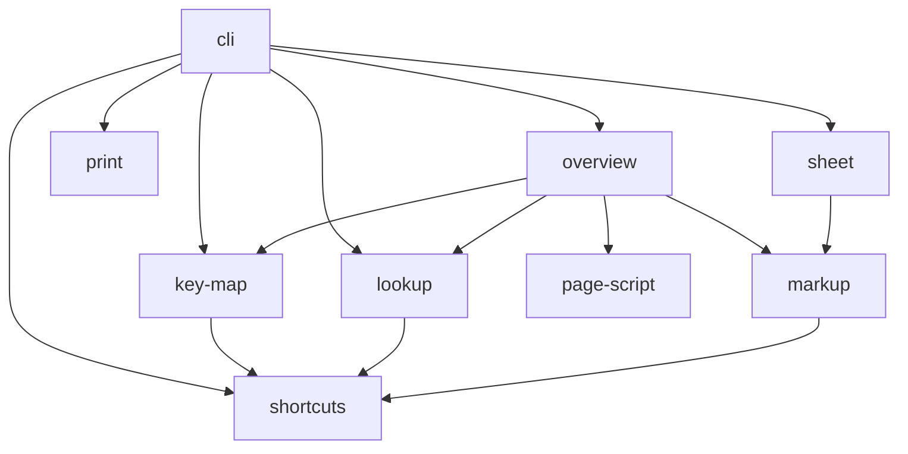

# src

The modules of the tool, for whoever changes them: their layers, which of
them touch files, and the imports between them.

## Layers

A module imports from this directory only modules of the layers below its
own; `tests/layers.test.js` fails otherwise. Lowest layer first:

| Layer        | Modules                             | Does                                                                                                                                                            |
| ------------ | ----------------------------------- | --------------------------------------------------------------------------------------------------------------------------------------------------------------- |
| Basics       | `shortcuts`, `page-script`, `print` | Reads and checks the shortcut map and parses its key strings; the overview page's behaviour in the browser; prints a page in a headless browser and measures it |
| Views        | `key-map`, `lookup`, `markup`       | Builds the key map cells; answers which entries, cells, combinations and characters use a key combination; escapes HTML and turns key strings into key caps     |
| Pages        | `overview`, `sheet`                 | Renders the overview page and the cheat sheet as HTML                                                                                                           |
| Command line | `cli`                               | Parses the arguments, reads the map, writes the pages and the PDF                                                                                               |

## Files

Only `cli` reads or writes files. Every other module takes data and returns
data, so the tests call them without files on disk; `print` launches a
headless browser for that, but hands the PDF back instead of writing it.

## Imports

Run `node scripts/module-diagram.js` after changing an import;
`npm run check` fails while the diagram below differs from the code.

<!-- module diagram: generated by scripts/module-diagram.js -->

<!-- end of module diagram -->
